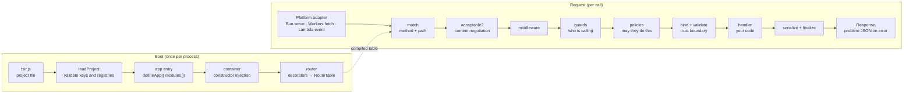
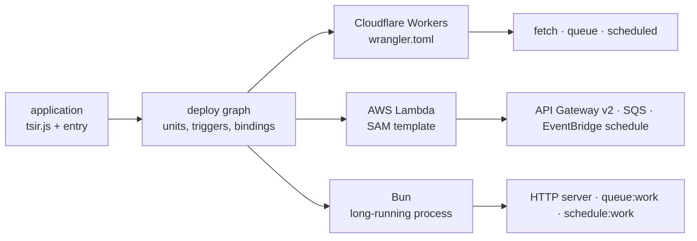
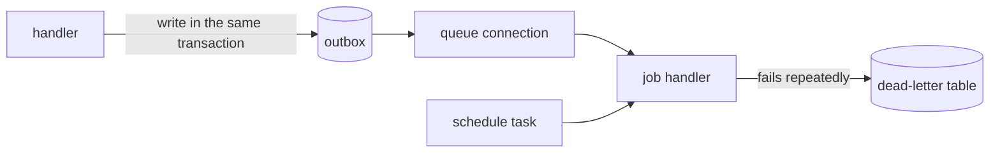

# Contributing to Tsir

Thanks for helping build Tsir. This guide explains how the project is laid out, how a request
travels through it, how we work with branches and pull requests, and how to propose a change
that needs discussion first.

## Index

- [Before you start](#before-you-start)
- [How Tsir works](#how-tsir-works)
  - [Boot and request flow](#boot-and-request-flow)
  - [Deploy flow](#deploy-flow)
- [Repository layout](#repository-layout)
  - [Root files and folders](#root-files-and-folders)
  - [`src/` folders](#src-folders)
  - [Framework packages](#framework-packages)
- [Development workflow](#development-workflow)
- [GitHub Flow](#github-flow)
- [Commit messages and changesets](#commit-messages-and-changesets)
- [Quality gates](#quality-gates)
- [RFCs: proposing a change](#rfcs-proposing-a-change)
  - [When an RFC is needed](#when-an-rfc-is-needed)
  - [The RFC process](#the-rfc-process)
  - [The RFC template](#the-rfc-template)
- [Security](#security)

## Before you start

You need [Bun](https://bun.sh) 1.2 or newer, Node.js 21 or newer (for tooling that expects it), and `make`.

```bash
make install   # install workspace dependencies (bun install --frozen-lockfile)
make check     # run every gate that CI runs; this is "is my branch sane?"
make dev       # start the example application for local work
```

Run `make help` to list every target with a one-line description.

## How Tsir works

Tsir is a set of small packages that an application composes. The application declares its
routes with decorators, and the framework compiles them into an immutable route table at boot.
The same table then serves requests on Bun, Cloudflare Workers, or AWS Lambda, because the
request pipeline is written against standard `Request` and `Response` objects.

### Boot and request flow



Three rules hold across that pipeline:

- Errors are caught in one boundary around the whole pipeline. A broken error mapper cannot turn
  into an unhandled rejection.
- Validation happens where data crosses a trust boundary (request body, query, message, config).
  Handler code receives typed values.
- A route timeout produces a response even if the handler ignores its abort signal.

### Deploy flow

The same application can be built into deployable units. `tsir deploy:build` resolves the unit
graph and emits platform artefacts.



A **unit** is one deployable piece: an HTTP app, a queue consumer, or a scheduled task. Each
unit declares the triggers it answers, so a connection with no trigger on the chosen target
fails the build instead of deploying silently.

### Background work



Events are typed. A listener runs inline or as a job, and a queued delivery is written in the
same batch as the change that caused it.

## Repository layout

### Root files and folders

| Path                                                                        | What it is                                                                   | Edit it?                                     |
| --------------------------------------------------------------------------- | ---------------------------------------------------------------------------- | -------------------------------------------- |
| `src/`                                                                      | All source: framework packages, applications, tools, and docs                | Yes, most work happens here                  |
| `bench/`                                                                    | Committed benchmark baseline (`baseline.json`) that `make bench` compares    | Only with `make bench-write`                 |
| `proto/`                                                                    | gRPC `.proto` contracts; `buf generate` turns them into committed code       | Yes, then run `make proto`                   |
| `rfc/`                                                                      | Public request-for-comments proposals (see [RFCs](#rfcs-proposing-a-change)) | Add a new file; never edit `0001`            |
| `.changeset/`                                                               | Pending release notes, one file per change                                   | Written by `make changeset`                  |
| `.github/`                                                                  | CI workflows, issue and pull request templates, code owners                  | Maintainers                                  |
| `Makefile`                                                                  | Every developer command, as `make <target>`                                  | Yes, keep help text current                  |
| `package.json`                                                              | Workspace manifest and root scripts                                          | Dependencies via `bun add`                   |
| `bun.lock`                                                                  | Locked dependency versions                                                   | Generated; never hand-edit                   |
| `tsconfig*.json`                                                            | TypeScript settings: base, workspace (`tsconfig.json`), and distribution     | Rarely                                       |
| `eslint.config.mjs`, `.prettierrc.json`, `.prettierignore`, `.editorconfig` | Lint and format rules                                                        | Rarely; discuss first                        |
| `commitlint.config.mjs`                                                     | Commit-message rules and allowed scopes                                      | Rarely; discuss first                        |
| `bunfig.toml`                                                               | Bun settings                                                                 | Rarely                                       |
| `buf.yaml`, `buf.gen.yaml`                                                  | `buf` lint and code-generation settings for `proto/`                         | Rarely                                       |
| `openapi.example.json`                                                      | Sample OpenAPI document                                                      | Yes, if an example changes                   |
| `status.json`                                                               | Single source of truth for the README status badge                           | Hand-edited; `make check` enforces agreement |
| `README.md`                                                                 | Project overview and badges (badges regenerate with `make readme`)           | Yes                                          |
| `LICENSE`                                                                   | MIT licence                                                                  | No                                           |
| `SECURITY.md`                                                               | How to report vulnerabilities (see [Security](#security))                    | Maintainers                                  |
| `CONTRIBUTING.md`                                                           | This guide                                                                   | Yes                                          |
| `renovate.json`                                                             | Automated dependency update settings                                         | Maintainers                                  |

Generated folders are listed in `.gitignore` and never committed: `node_modules/`, `dist/`
(the output of `make dist`), `coverage/`, and `.tsir/` (runtime state).

### `src/` folders

| Folder           | What it contains                                                                                                             |
| ---------------- | ---------------------------------------------------------------------------------------------------------------------------- |
| `src/framework/` | One folder per package (`src/framework/<name>/`). This is the product.                                                       |
| `src/apps/`      | Applications: `examples/` (small apps that show features), `docs/`, and `frontpage/` (the marketing site)                    |
| `src/tools/`     | Repository tooling: gates (`check-*.ts`), `dist.ts`, `bench.ts`, `version.ts`, and the `tools.test.ts` suite                 |
| `src/docs/`      | Documentation that the tools check: the API surface snapshot, error codes, errors table, dependency policy, migrations guide |

Inside a package, the layout is the same everywhere:

```text
src/framework/<name>/
├── package.json     the manifest: name, exports, dependencies
├── README.md        what the package is for and what it guarantees
└── src/             the implementation, with its *.test.ts tests beside it
```

### Framework packages

| Package     | Purpose                                                                                     |
| ----------- | ------------------------------------------------------------------------------------------- |
| `core`      | Application lifecycle, module registry, manifest, and `defineApp`                           |
| `container` | Constructor-based dependency injection. Leaf package with no other `@tsir` dependencies     |
| `config`    | Typed, validated, redacted configuration, and the managed-region writer for generated code  |
| `validate`  | Zod-backed validation at every trust boundary, exposed through Standard Schema              |
| `router`    | Decorators (`@Controller`, route methods) compiled into an immutable route table            |
| `http`      | The Web-standard request pipeline: matching, binding, guards, policies, responses           |
| `console`   | The `tsir` CLI: lifecycle, diagnostics, generators, and configuration automation            |
| `database`  | D1-first database layer with explicit capabilities; Postgres through an app-supplied client |
| `migrate`   | Applies Drizzle migration journals with advisory locks, checksums, and drift detection      |
| `seed`      | Deterministic, idempotent seeders with environment gating                                   |
| `cache`     | Named cache stores with explicit serialization and no silent fallback                       |
| `queue`     | Named job connections: at-least-once delivery, backoff, dead-letter table, idempotency keys |
| `events`    | Typed events and the transactional outbox; listeners run inline or as jobs                  |
| `schedule`  | Cron tasks with overlap prevention through a distributed lock                               |
| `notify`    | Notifications over mail, database inbox, and webhooks, queued by default                    |
| `mail`      | Mail composition and sending through one transport port, with escaped templates             |
| `storage`   | Named object-storage disks: bytes in, bytes out, signed or public URLs                      |
| `link`      | Service-to-service calls over REST, gRPC, SOAP, and WebSocket with one `CallContext`        |
| `vault`     | Versioned, authenticated column encryption with a key-rotation ledger                       |
| `auth`      | Authentication primitives, such as password hashing adapters                                |
| `policy`    | Authorization: roles, permissions, and the decision record                                  |
| `pulse`     | Logging, metrics, tracing, and health checks; telemetry never fails a service call          |
| `deploy`    | Compiles an application into deployable units and emits Workers and Lambda artefacts        |
| `testing`   | Test harness that boots the real application with a deterministic clock and randomness      |

## Development workflow

1. **Find or open an issue.** A bug goes to the issue tracker with a reproduction. A new feature,
   a breaking change, or a process change starts as an [RFC](#rfcs-proposing-a-change).
2. **Make the change on a branch** (see [GitHub Flow](#github-flow)).
3. **Keep the change small and in one package** when you can. A change that touches several
   packages should say why in the pull request.
4. **Add or update tests with the change.** A behaviour change without a test needs a reason in the
   pull request.
5. **Run `make check`** before you push. CI runs the same gates.
6. **Record a changeset** for anything users will notice: `make changeset SUMMARY="..." BUMP=patch`.
7. **Open a pull request** and fill in every section of the template. A section that does not
   apply says so in one line.

## GitHub Flow

Tsir uses [GitHub Flow](https://docs.github.com/en/get-started/using-github/github-flow): one
long-lived branch, `main`, that is always in a releasable state, and short-lived branches for
everything else.

1. **Branch from `main`.** Name it for the change, for example `router/route-params` or
   `docs/contributing`.
2. **Commit in small steps** using the [commit rules](#commit-messages-and-changesets).
3. **Open a pull request early.** A draft is fine. The description says what is changing and why.
4. **CI must pass.** The `check` job runs type checks, lint, boundaries, tests, and a distribution
   build. The `frontpage` and `integration` jobs run too.
5. **Get a review.** Code owners are listed in `.github/CODEOWNERS`. The paths marked high-risk
   there need a second reviewer.
6. **Merge into `main`** once CI is green and the review is approved. Delete the branch after
   merging.
7. **Releases come from `main`.** Maintainers apply pending changesets (`make release-version`) and
   cut the release. Changes reach `main` through pull requests.

If `main` moves while your branch is open, rebase or merge `main` into your branch, and wait for
CI to pass again.

## Commit messages and changesets

Commits follow [Conventional Commits](https://www.conventionalcommits.org). The header names a
type and a scope that exists as a package, so the changelog says what changed and where:

```text
feat(router): add a route-level timeout option
fix(http): return 415 for an unsupported content type
docs(repo): explain the RFC process
```

- **Types:** `feat`, `fix`, `docs`, `refactor`, `test`, `chore`, `ci`, `build`, `perf`, `revert`.
- **Scopes:** `router`, `http`, `validate`, `core`, `container`, `config`, `console`, `testing`,
  `frontpage`, `tools`, `ci`, `release`, `deps`, and `repo`. A scope that is not in
  `commitlint.config.mjs` is refused.
- **Subject:** lower case, and the whole header is at most 100 characters.

Changesets are the release notes. `make changeset` writes one file in `.changeset/`. A change
that users cannot see (a test, a comment, a refactor with no behaviour change) does not need one.

## Quality gates

`make check` runs every gate CI runs, and the table below lists the main ones. Run it before you
push. `make help` lists all targets.

| Gate                      | Target                                         | What it proves                                             |
| ------------------------- | ---------------------------------------------- | ---------------------------------------------------------- |
| Types                     | `make typecheck`                               | The whole workspace type-checks                            |
| Lint                      | `make lint`                                    | Type-aware lint passes                                     |
| Boundaries                | `make boundaries`                              | Package import boundaries hold                             |
| Modules                   | `make modules`                                 | Application module boundaries hold                         |
| Dependency policy         | `make deps`                                    | Every runtime dependency is on the allowlist               |
| Error codes               | `make error-codes`                             | Error codes are registered and documented                  |
| API surface               | `make surface`                                 | Public exports match the committed snapshot                |
| Links                     | `make links`                                   | Internal Markdown links resolve                            |
| README                    | `make readme-check`                            | Badges match the repository                                |
| Formatting                | `make format-check`                            | Prettier is satisfied                                      |
| Coercion, crypto, licence | `make coercion`, `make crypto`, `make license` | No implicit coercion, no prohibited crypto, licences agree |
| Contracts (proto)         | `make proto-check`                             | Committed gRPC contracts match `proto/` (needs `buf`)      |

Tests run with `make test` (or `bun test`). `make coverage` runs the coverage gate. Database-backed
suites run with `make test-integration`; without `DATABASE_URL` set, that target prints which suites
it skipped and exits 0.

## RFCs: proposing a change

An RFC is a written proposal for changing the project itself. We write one before the work
starts, so the design can be argued with while it is still cheap to change.

### When an RFC is needed

Open an RFC for:

- **New features:** a capability, a package, an entry point, or a public API that does not exist.
- **Breaking changes:** anything that removes, renames, or changes the meaning of something that
  is released or documented as stable.
- **Tooling and process that improve the project:** a generator, a gate, a CI job, a build
  step, a testing strategy, or a change to how we review.

Do **not** use an RFC for a bug. A defect is an issue with a reproduction. If your first sentence
is "X is broken", open an issue instead.

### The RFC process

```text
Draft ──▶ Discussion ──▶ Accepted ──▶ implementation (a tracked task)
  │            │
  │            ├──▶ Rejected   (kept, with the reason)
  └──▶ Withdrawn (author steps back; kept for history)
```

1. **Draft.** Copy `rfc/0001-sample-template-here.md` to `rfc/NNNN-kebab-case-title.md`, using the
   next free number. Numbers are four digits and start at `0002`. `0001` is the template and is
   never edited. Fill in every section, and open a pull request. The file name is the proposal's
   identity.
2. **Discussion.** The pull request's comment thread is the discussion. Amend the RFC file as the
   argument moves, so the reasoning is recorded in the file and not only in comments.
3. **Decision.** A maintainer sets `Status` to `Accepted`, `Rejected`, or `Withdrawn` and adds a
   line to the review log at the bottom of the file. A rejected RFC stays in the repository, so
   the same idea is not proposed again without new information.
4. **Implementation.** An accepted RFC that needs code gets a tracked task. If it changes
   architecture, it also gets a decision record. The RFC stays as the record of the argument.

An RFC is never deleted, and a number is never reused.

### The RFC template

The template is [`rfc/0001-sample-template-here.md`](rfc/0001-sample-template-here.md). Every RFC
keeps these sections, in this order:

| #   | Section                 | What goes in it                                                            |
| --- | ----------------------- | -------------------------------------------------------------------------- |
| 1   | Summary                 | One paragraph: what is proposed, what it costs, and whether it is breaking |
| 2   | Motivation              | The problem, described through an application that needs it                |
| 3   | Proposed design         | The design in enough detail to build it; the public API as code            |
| 4   | Alternatives considered | Other designs, and why they were not chosen                                |
| 5   | Impact                  | Packages, users, performance, security, and dependencies affected          |
| 6   | Migration and rollout   | How existing applications move, and whether anything is opt-in             |
| 7   | Testing                 | What proves the design works                                               |
| 8   | Evidence                | Measurements, prior art, and links that support the design                 |
| 9   | Open questions          | What is still undecided, and who decides it                                |
| 10  | Review log              | Dated decisions and their reasons, added by maintainers                    |

The header block at the top of every RFC has these fields:

```markdown
# RFC NNNN — Title in the imperative: "Add X", "Replace Y with Z", "Make W configurable"

- **Status:** Draft
- **Date:** YYYY-MM-DD
- **Author:** your name or handle
- **Affects:** packages, entry points, CLI commands, gates, or targets this proposal touches
- **Related:** tasks or decisions it depends on, if any
```

Delete the instruction blockquotes in the template when you write your RFC. They are guidance for
authors, not part of the proposal.

## Security

**Do not open a public issue or pull request for a security concern.**

If you find a vulnerability, or think something may be a security problem, email
**[hello@daisoncarino.com](mailto:hello@daisoncarino.com)**. Include the affected package and
version, the smallest reproduction you can build, and what an attacker could gain. Please do not
share details publicly until the issue has been fixed.

Everything else about contributing is public, including RFCs, issues, and pull requests.
